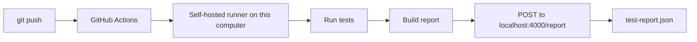

# Assignment Submission Portal

[](https://github.com/HuzaifaQ-1/assignment-submission-portal/actions/workflows/ci.yml)

Students submit a link to their assignment. Every push to this repository is tested automatically, and the test results are delivered to a JSON file on the developer's own computer.

**Live demo:** https://huzaifaq-1.github.io/assignment-submission-portal/

## What is in this repository

| Path | Purpose |
|---|---|
| `src/` | Express server, API and submission storage |
| `public/` | The web page, including validation rules shared with the server |
| `tests/` | Automated tests |
| `receiver/` | Local HTTP receiver that saves `test-report.json` |
| `scripts/` | Builds and sends the report, sends the email, builds the Pages demo |
| `.github/workflows/ci.yml` | The CI pipeline |

## Requirements

- [Node.js](https://nodejs.org/) 20 or newer
- Git

Install the dependencies once:

```bash
npm install
```

## Run the application

```bash
npm start
```

Open http://localhost:3000. Submissions are saved in `data/submissions.json`.

## Run the tests

```bash
npm test
```

| Test | Expected result |
|---|---|
| Complete details and a valid submission URL | Saved and shown in the list |
| Missing registration number | Rejected with a validation message |
| Invalid submission URL | Rejected and not saved |
| Unsafe `javascript:` link | Rejected and not saved |
| Saved submissions after a restart | Still listed |

## Start the report receiver

```bash
npm run receiver
```

The receiver listens on http://localhost:4000/report. Each report it accepts replaces `test-report.json` in the project folder, and a dated copy is kept in `report-history/`.

## How the results reach this computer

A GitHub-hosted runner's `localhost` is the runner itself, so it cannot reach a receiver on this computer. This project uses a **self-hosted runner** instead: GitHub still starts the pipeline on every push, but the job runs on this computer, where `localhost` is the receiver.



### Set up the runner (once)

1. In the repository, open **Settings → Actions → Runners → New self-hosted runner** and choose **Windows x64**.
2. Follow the download and configure commands on that page, adding `--labels lab-mid` to the `config.cmd` command.

The runner must have Node.js and Git available.

### Before pushing

Keep both of these running:

```bash
npm run receiver
```

```bash
run.cmd
```

`run.cmd` is started from the runner's own folder. If the runner is offline, a pushed revision waits in the queue and runs when the runner starts. If the receiver is off, the pipeline fails with an error saying that the report could not be delivered.

## The pipeline

Every push starts [`ci.yml`](.github/workflows/ci.yml):

1. **Test and report** checks out the pushed revision, installs dependencies and runs the tests. A failed test fails this job. The report and email steps run whether the tests passed or failed.
2. **Publish GitHub Pages demo** runs only for pushes to `main`, and only when the test job succeeded. A failing run skips it, so the previously published version stays online. The footer of the published page shows the commit it was built from.

GitHub Pages cannot run a server, so the published demo saves submissions in the visitor's browser. It uses the same validation rules as the portal.

## The test report

```json
{
  "repository": "HuzaifaQ-1/assignment-submission-portal",
  "branch": "main",
  "commitSha": "4f1c2ab9e0d7c6b5a4f3e2d1c0b9a8f7e6d5c4b3",
  "pipelineRunId": "19283746501",
  "pipelineRunUrl": "https://github.com/HuzaifaQ-1/assignment-submission-portal/actions/runs/19283746501",
  "executedAt": "2026-11-09T10:15:30.000Z",
  "tests": [
    {
      "name": "Invalid submission URL: rejected and not saved",
      "result": "failed",
      "failureMessage": "Expected: 400\nReceived: 201"
    }
  ],
  "summary": {
    "total": 5,
    "passed": 4,
    "failed": 1,
    "status": "failed"
  }
}
```

If the tests cannot run at all, for example because a file has a syntax error, the report is still sent with a `failed` status and the reason.

## Email report

After each run the pipeline can email the report, with the commit, overall result, test counts and each test's result, and `test-report.json` attached. It is skipped until these repository secrets exist:

| Secret | Value |
|---|---|
| `SMTP_USER` | Sending address, for example a Gmail address |
| `SMTP_PASS` | Password for that account; for Gmail, an App Password |
| `MAIL_TO` | Address that receives the report |

Each command below asks for the value privately. Run the last one again to change the recipient.

```bash
gh secret set SMTP_USER
```

```bash
gh secret set SMTP_PASS
```

```bash
gh secret set MAIL_TO
```

The defaults are Gmail's server, `smtp.gmail.com` on port 465. For another provider, set the repository variables `SMTP_HOST` and `SMTP_PORT`.

## Demonstrate pass, fail and fix

With the receiver and runner running:

1. **Pass:** push a working revision. The pipeline is green and `test-report.json` shows `"status": "passed"`.
2. **Fail:** in `public/validation.js`, inside `isValidSubmissionUrl`, change `return false;` in the `catch` block to `return true;`, then commit and push. The test job is red, the Pages job is skipped and `test-report.json` shows the failed test.
3. **Fix:** change it back to `return false;`, then commit and push. The pipeline is green again and `test-report.json` shows `"status": "passed"`.

## Settings

| Environment variable | Default | Used by |
|---|---|---|
| `PORT` | `3000` | Portal |
| `DATA_FILE` | `data/submissions.json` | Portal |
| `RECEIVER_PORT` | `4000` | Receiver |
| `REPORT_FILE` | `test-report.json` | Receiver |
| `REPORT_URL` | `http://127.0.0.1:4000/report` | Pipeline report step |

## Security notes

- The receiver and the portal listen on `127.0.0.1` only, so other computers cannot reach them.
- The pipeline runs on `push` only, and the repository requires a maintainer's approval before workflows from outside contributors can run. Pull requests from strangers therefore cannot run code on the self-hosted runner.
- Email credentials are kept in GitHub Actions secrets and are never stored in the code.
